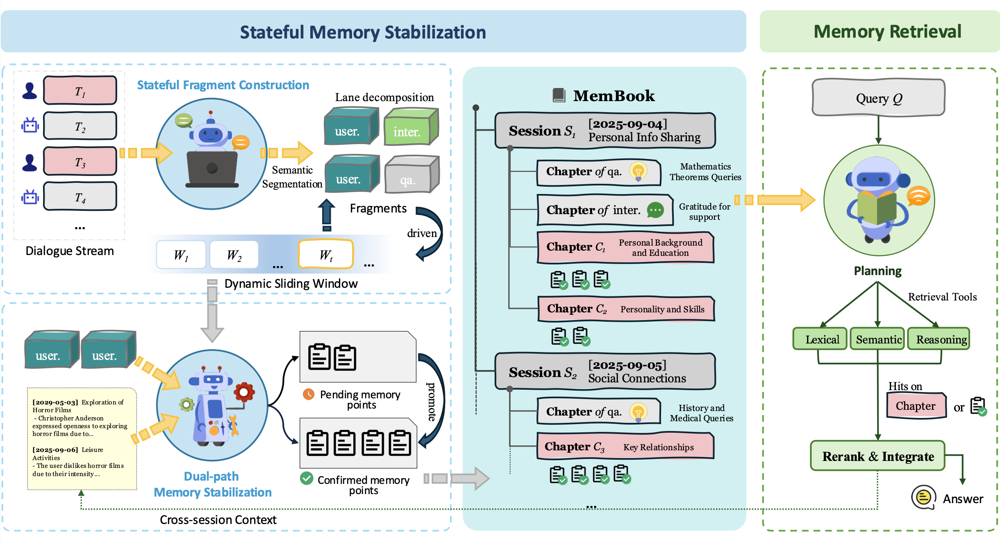
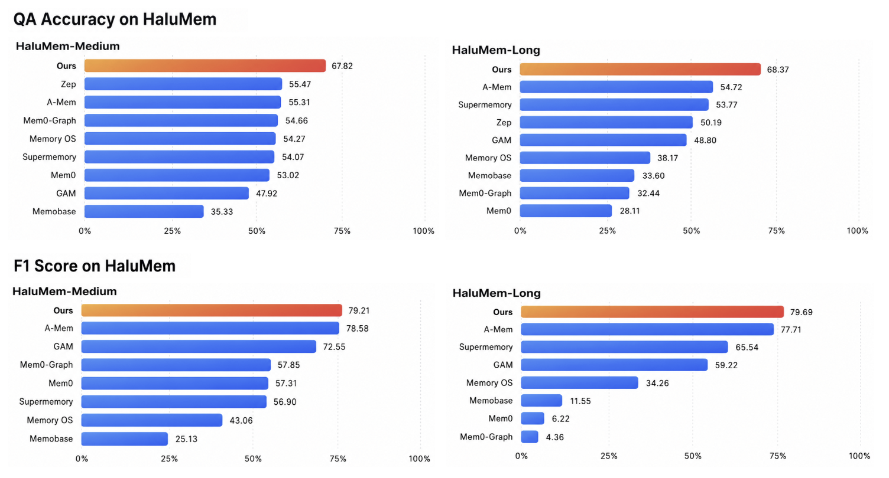

# MemBook: A Hierarchical Reasoning-based Memory Framework for Hallucination-Resistant LLM Agents

[中文文档](README_CN.md) | English

Accepted to **EMNLP 2026**.

## 🧠 Overview

We introduce **MemBook**, a hierarchical time-aware memory framework designed to improve memory reliability for long-term LLM agents.

MemBook contains two key components:

- **Stateful Memory Stabilization**
  - Maintains reliable memory through a pending–confirmed verification mechanism.
  - Separates durable user information from transient QA and interaction content using multi-lane memory isolation.
  - Organizes memories into a hierarchical structure: **Session → Chapter → Memory Point**.
- **Hierarchical Memory Retrieval**
  - Performs reasoning-based navigation over the memory hierarchy.
  - Combines lexical retrieval, semantic retrieval, and reasoning-based retrieval.
  - Improves temporal consistency and logical relevance during memory access.

Our experiments on **HaluMem-Medium**, **HaluMem-Long**, and **LongMemEval** demonstrate that MemBook improves long-term memory extraction, retrieval, and downstream QA performance while reducing hallucination propagation.


## 🏗️ Framework

<p align="center">
  
</p>

## ✨ Highlights

MemBook delivers consistently strong results across benchmarks: **79.21 / 79.69 Extraction F1** and **67.82 / 68.37 QA accuracy** on HaluMem-Medium / Long, with the lowest hallucination rates (**12.78 / 12.84**) and **69.4 overall accuracy** on LongMemEval using gpt-4o-mini. Notably, MemBook remains stable under ultra-long contexts, while most competing memory systems suffer sharp performance drops as the context length increases.

<p align="center">
  
</p>

#### 🔹HaluMem-Medium

| Method | Extraction F1 ↑ | QA Acc. ↑ | Halluc. ↓ |
| :----: | :-------------: | :-------: | :-------: |
| Mem0 | 57.31 | 53.02 | 19.17 |
| Mem0-Graph | 57.85 | 54.66 | 19.28 |
| A-Mem | <u>78.58</u> | 55.31 | 23.04 |
| Supermemory | 56.90 | 54.07 | 22.24 |
| Memobase | 25.13 | 35.33 | 29.97 |
| Zep | - | <u>55.47</u> | 21.92 |
| Memory OS | 43.06 | 54.27 | 37.80 |
| GAM | 72.55 | 47.92 | <u>14.73</u> |
| **MemBook** | **79.21** | **67.82** | **12.78** |

#### 🔸HaluMem-Long

| Method | Extraction F1 ↑ | QA Acc. ↑ | Halluc. ↓ |
| :----: | :-------------: | :-------: | :-------: |
| Mem0 | 6.22 | 28.11 | 17.29 |
| Mem0-Graph | 4.36 | 32.44 | 21.82 |
| A-Mem | <u>77.71</u> | <u>54.72</u> | 24.11 |
| Supermemory | 65.54 | 53.77 | 22.21 |
| Memobase | 11.55 | 33.60 | 29.46 |
| Zep | - | 50.19 | 22.51 |
| Memory OS | 34.26 | 38.17 | 42.07 |
| GAM | 59.22 | 48.80 | <u>13.32</u> |
| **MemBook** | **79.69** | **68.37** | **12.84** |

### 


## 📁 Project Structure

```
MemBook/
├── membook/                              # Core package
│   ├── agents/
│   │   ├── memory_agent.py               # Construction (MemoryAgent)
│   │   └── research_agent.py             # Retrieval (ResearchAgent)
│   ├── memory/toc/                       # ToC builder, lanes, stabilization
│   ├── generator/                        # OpenAI-compatible (default) / optional vLLM
│   ├── retriever/                        # Index / BM25 / dense
│   ├── prompts/                          # Construction + retrieval prompts
│   ├── schemas/
│   ├── usage/                            # Optional LLM usage stats
│   └── config/
├── eval/halumem/                         # HaluMem: eval_membook.py + run_membook.bash
├── eval/baseline/longmemeval_membook.py  # LongMemEval runner (used by script below)
├── scripts/eval_longmemeval_membook.sh
├── examples/quickstart/
├── assets/membook-architecture.png
├── pyproject.toml
├── requirements.txt
└── README.md
```


## ⚙️ Installation

**Requirements**

- Python >= 3.10
- OpenAI API or compatible LLM endpoint

```bash
git clone https://github.com/springCozyRock/MemBook.git
cd MemBook

pip install -e .

export OPENAI_API_KEY="your_api_key"
export OPENAI_BASE_URL="https://api.openai.com/v1"
```


## 🚀 Quick Start

```bash
cd examples/quickstart
python basic_usage.py
```

## 📊 Evaluation

Download the benchmark data locally, then run the scripts below.

### HaluMem

**Data:** [IAAR-Shanghai/HaluMem](https://huggingface.co/datasets/IAAR-Shanghai/HaluMem) ([MemTensor/HaluMem](https://github.com/MemTensor/HaluMem))

```bash
mkdir -p data/halumem
cd data/halumem
wget https://huggingface.co/datasets/IAAR-Shanghai/HaluMem/resolve/main/HaluMem-Medium.jsonl
wget https://huggingface.co/datasets/IAAR-Shanghai/HaluMem/resolve/main/HaluMem-Long.jsonl
cd ../..
```

Expected layout:

```text
data/halumem/HaluMem-Medium.jsonl
data/halumem/HaluMem-Long.jsonl
```

**Run:**

```bash
cd eval/halumem
bash run_membook.bash  # edit dataset_list / models / max_users at the top of the script
```

Or step by step:

```bash
cd eval/halumem
python eval_membook.py --medium --frame membook --version medium
python evaluation.py --frame membook --version medium
```

Details: [eval/halumem/README.md](./eval/halumem/README.md).

### LongMemEval

**Data:** cleaned LongMemEval-S from [xiaowu0162/longmemeval-cleaned](https://huggingface.co/datasets/xiaowu0162/longmemeval-cleaned); official code [xiaowu0162/LongMemEval](https://github.com/xiaowu0162/LongMemEval) for reading templates and `evaluate_qa`.

```bash
mkdir -p data/longmemeval
cd data/longmemeval
wget https://huggingface.co/datasets/xiaowu0162/longmemeval-cleaned/resolve/main/longmemeval_s_cleaned.json
git clone https://github.com/xiaowu0162/LongMemEval.git LongMemEval-main
cd ../..
```

**Run:**

```bash
./scripts/eval_longmemeval_membook.sh
```

## 📝 Citation

Coming soon.

## 📄 License

MIT — see [LICENSE](LICENSE).
