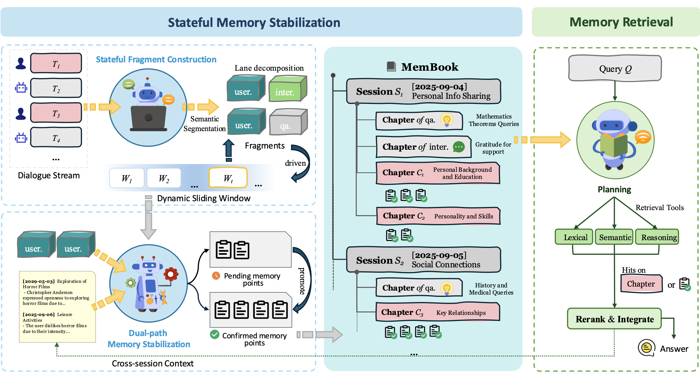
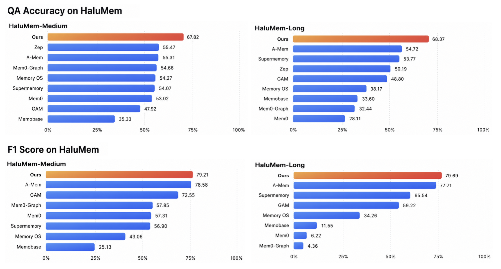

# MemBook: 面向抗幻觉智能体的分层推理记忆框架

**MemBook: A Hierarchical Reasoning-based Memory Framework for Hallucination-Resistant LLM Agents**

[English](README.md) | 中文文档

论文已被 **EMNLP 2026** 录用。

## 🧠 概览

我们提出 **MemBook**，一种分层、时间感知的记忆框架，用于提升长期 LLM Agent 的记忆可靠性。

MemBook 包含两个核心模块：

- **Stateful Memory Stabilization（有状态记忆稳定化）**
  - 通过 pending–confirmed 校验机制维护可靠记忆。
  - 用多车道隔离区分用户持久信息与短暂 QA / 交互内容。
  - 将记忆组织为层级结构：**Session → Chapter → Memory Point**。
- **Hierarchical Memory Retrieval（分层记忆检索）**
  - 在记忆层级上做基于推理的导航。
  - 联合词法检索、语义检索与推理检索。
  - 提升记忆访问的时间一致性与逻辑相关性。

在 **HaluMem-Medium**、**HaluMem-Long** 与 **LongMemEval** 上的实验表明，MemBook 提升了长期记忆抽取、检索与下游 QA 表现，并抑制幻觉跨阶段传播。

## 🏗️ 框架

<p align="center">
  
</p>

## ✨ 亮点

从 Medium 到 Long 表现保持稳定（默认 gpt-4o），在 HaluMem-Long 上相对代表性系统 **GAM 绝对提升 19.57%**：

<p align="center">
  
</p>

#### 🔹HaluMem-Medium

| 方法 | 抽取 F1 ↑ | QA Acc. ↑ | 幻觉率 ↓ |
| :--: | :-------: | :-------: | :------: |
| Mem0 | 57.31 | 53.02 | 19.17 |
| Mem0-Graph | 57.85 | 54.66 | 19.28 |
| A-Mem | <u>78.58</u> | 55.31 | 23.04 |
| Supermemory | 56.90 | 54.07 | 22.24 |
| Memobase | 25.13 | 35.33 | 29.97 |
| Zep | - | <u>55.47</u> | 21.92 |
| Memory OS | 43.06 | 54.27 | 37.80 |
| GAM | 72.55 | 47.92 | <u>14.73</u> |
| **MemBook** | **79.21** | **67.82** | **12.78** |

#### 🔸HaluMem-Long

| 方法 | 抽取 F1 ↑ | QA Acc. ↑ | 幻觉率 ↓ |
| :--: | :-------: | :-------: | :------: |
| Mem0 | 6.22 | 28.11 | 17.29 |
| Mem0-Graph | 4.36 | 32.44 | 21.82 |
| A-Mem | <u>77.71</u> | <u>54.72</u> | 24.11 |
| Supermemory | 65.54 | 53.77 | 22.21 |
| Memobase | 11.55 | 33.60 | 29.46 |
| Zep | - | 50.19 | 22.51 |
| Memory OS | 34.26 | 38.17 | 42.07 |
| GAM | 59.22 | 48.80 | <u>13.32</u> |
| **MemBook** | **79.69** | **68.37** | **12.84** |

### 


## 📁 项目结构

```
MemBook/
├── membook/                              # 核心包
│   ├── agents/
│   │   ├── memory_agent.py               # 构建（MemoryAgent）
│   │   └── research_agent.py             # 检索（ResearchAgent）
│   ├── memory/toc/                       # ToC 构建、车道与稳定化
│   ├── generator/                        # 默认 OpenAI 兼容；可选 vLLM
│   ├── retriever/                        # Index / BM25 / dense
│   ├── prompts/                          # 构建 + 检索侧 prompt
│   ├── schemas/
│   ├── usage/                            # 可选 token 统计
│   └── config/
├── eval/halumem/                         # HaluMem：eval_membook.py + run_membook.bash
├── eval/baseline/longmemeval_membook.py  # LongMemEval 入口（供下方脚本调用）
├── scripts/eval_longmemeval_membook.sh
├── examples/quickstart/
├── assets/membook-architecture.png
├── pyproject.toml
├── requirements.txt
└── README_CN.md
```


## ⚙️ 安装

**环境要求**

- Python >= 3.10
- OpenAI API 或兼容 LLM 接口

```bash
git clone https://github.com/springCozyRock/MemBook.git
cd MemBook

pip install -e .

export OPENAI_API_KEY="your_api_key"
export OPENAI_BASE_URL="https://api.openai.com/v1"
```


## 🚀 快速开始

```bash
cd examples/quickstart
python basic_usage.py
```

## 📊 评测

请先本地下载评测数据，再运行对应脚本。

### HaluMem

**数据：** [IAAR-Shanghai/HaluMem](https://huggingface.co/datasets/IAAR-Shanghai/HaluMem)（说明见 [MemTensor/HaluMem](https://github.com/MemTensor/HaluMem)）

```bash
mkdir -p data/halumem
cd data/halumem
wget https://huggingface.co/datasets/IAAR-Shanghai/HaluMem/resolve/main/HaluMem-Medium.jsonl
wget https://huggingface.co/datasets/IAAR-Shanghai/HaluMem/resolve/main/HaluMem-Long.jsonl
cd ../..
```

期望目录：

```text
data/halumem/HaluMem-Medium.jsonl
data/halumem/HaluMem-Long.jsonl
```

**运行：**

```bash
cd eval/halumem
bash run_membook.bash  # 可在脚本顶部改 dataset_list / 模型 / max_users
```

或分步：

```bash
cd eval/halumem
python eval_membook.py --medium --frame membook --version medium
python evaluation.py --frame membook --version medium
```

更多说明见 [eval/halumem/README.md](./eval/halumem/README.md)。

### LongMemEval

**数据：** cleaned LongMemEval-S 来自 [xiaowu0162/longmemeval-cleaned](https://huggingface.co/datasets/xiaowu0162/longmemeval-cleaned)；官方代码 [xiaowu0162/LongMemEval](https://github.com/xiaowu0162/LongMemEval) 用于阅读模板与 `evaluate_qa` 判分。

```bash
mkdir -p data/longmemeval
cd data/longmemeval
wget https://huggingface.co/datasets/xiaowu0162/longmemeval-cleaned/resolve/main/longmemeval_s_cleaned.json
git clone https://github.com/xiaowu0162/LongMemEval.git LongMemEval-main
cd ../..
```

**运行：**

```bash
./scripts/eval_longmemeval_membook.sh
```

## 📝 引用

Coming soon.

## 📄 许可证

MIT — 见 [LICENSE](LICENSE)。
